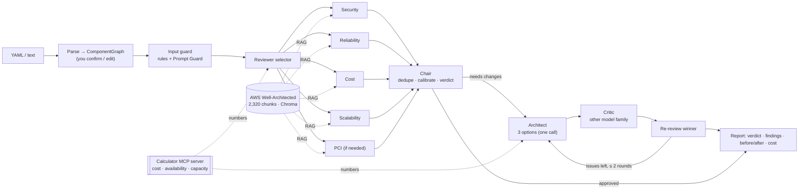

# 🏛️ ArchOptimize AI — an AI Architecture Review Board

Paste an AWS system design (YAML or plain text) with its requirements — uptime SLO, peak
traffic, latency, budget, compliance. A team of AI agents reviews it like a company's
Architecture Review Board, cites the **AWS Well-Architected Framework**, proposes **three
redesigns**, lets an independent **Critic** pick one, re-checks it, and returns a verdict
with **before/after diagrams and calculated cost, availability and capacity**.

**Try it:** [archoptimize-ai.onrender.com](https://archoptimize-ai.onrender.com) — open a
demo review without any key, or paste a free [Groq](https://console.groq.com/keys) key to
review your own design. (Free hosting sleeps when idle: the first visit takes ~1 minute.)

> **AI suggestion, not an approval.** A personal learning project — estimates are
> approximate. Don't paste confidential designs (free models may log prompts).

## How it works



| Concept | Where |
|---|---|
| Multi-agent orchestration (LangGraph, parallel `Send`, conditional loop) | `archoptimize/review_workflow/` |
| Structured output — every agent returns a Pydantic model | `archoptimize/schemas/`, `agents/agent_base.py` |
| RAG with citation validation (fastembed bge-small, Chroma) | `knowledge_base/`, `retrieval/` |
| Tree of Thoughts + reflection (Architect → Critic → re-review) | `agents/architect_agent.py`, `agents/critic_agent.py` |
| MCP tools (FastMCP server, langchain-mcp-adapters client) | `mcp_server/`, `calculators/` |
| Model routing: Groq primary, free OpenRouter models picked at runtime | `llm/model_router.py`, `config/llm_roles.yaml` |
| Prompt-injection defence (untrusted-input wrapping, Prompt Guard) | `core/untrusted_input.py`, `agents/input_guard.py` |
| Eval-driven development (15 planted-flaw designs) | `evaluation/` |

## Results (evaluation on 15 designs with 19 planted flaws)

| Reviewer | Flaws found | False alarms | Correct verdict | Notes |
|---|---|---|---|---|
| Rubber stamp (approve everything) | 0% | 0 | 7% | floor |
| Single LLM call | 84% | 23 | 100% | 27 s, 4.7k tokens |
| Single LLM + RAG | 90% | 23 | 93% | 85% of findings cited |
| Multi-agent board | 90% | 40 | 100% | 92 s, 17.7k tokens |
| Board + Architect/Critic redesign | 79%* | 26 | 73%* | **80% of flaws fixed** in the redesign, 287 s, ~62k tokens |

\* 2 of 15 cases failed on the Groq free-tier daily token limit. A clean re-run is pending.

Honest reading: the board's main gain is the redesign (it fixes what it finds). It doesn't
find more flaws than one well-prompted call with RAG, and it costs far more tokens.

## Run locally

```powershell
uv sync                                              # Python 3.12 env + dependencies
Copy-Item .env.example .env                          # add your GROQ_API_KEY (+ optional OPENROUTER_API_KEY)
uv run python -m archoptimize.knowledge_base.index_builder   # build the docs index once (~6 min)
uv run python app.py                                 # http://127.0.0.1:7860
```

Other commands:

```powershell
uv run python -m pytest                              # unit tests (no keys needed)
uv run python -m pytest -m live                      # real API calls
uv run python -m evaluation.run_evaluation --reviewer board_redesign
uv run python -m archoptimize.cli preview my_design.yaml     # validate + Mermaid
uv run python -m archoptimize.mcp_server.calculator_server   # the MCP server on its own
```

## Limits

- Free tiers: Groq allows ~8k tokens/minute per model, so a full review takes 1–3 minutes.
- Hosted on Render's free tier (512 MB RAM, sleeps after 15 min idle → ~1 min cold start).
- Prices are an approximate us-east-1 snapshot; availability uses public SLA tiers.
- Image (diagram) input is not in the MVP.

Docs: [`docs/`](docs/) (brief, overview, structure) · build plan and decision log: [`PLAN.md`](PLAN.md).
