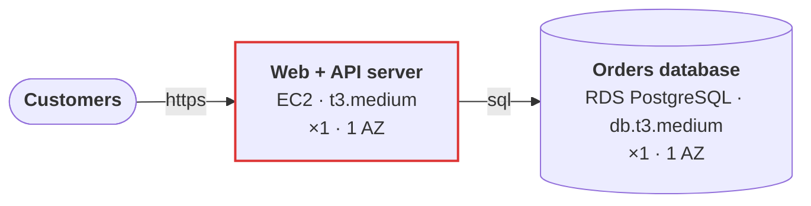

# ArchOptimize AI — Architecture Review Board Agent

A multi-agent system that reviews an AWS system design against its requirements (SLO, RPS, budget, compliance), cites AWS Well-Architected guidance, and proposes a revised design.

Work in progress — see `docs/` (brief, overview, structure) and `PLAN.md`.

## Local setup

```powershell
uv sync                       # create .venv and install deps
Copy-Item .env.example .env   # then put your own keys in .env
uv run python -m pytest       # unit tests (no keys needed); add -m live for real API calls
uv run python -m archoptimize.llm.smoke_check   # live check: needs keys in .env
```

## Try it: design → diagram

```powershell
uv run python -m archoptimize.cli template > my_design.yaml   # commented template
uv run python -m archoptimize.cli preview my_design.yaml      # validate + Mermaid diagram
```

The template design renders as (red border = internet-facing):


